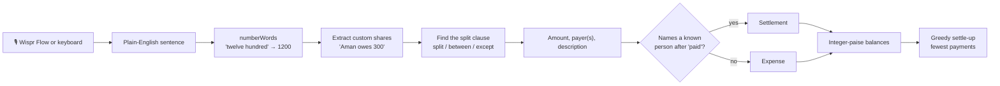

# 🌴 SplitGoa

**Split trip expenses by just saying what happened.**
Type or dictate sentences like *"Rahul paid twelve hundred for dinner, Aman owes 300"*. SplitGoa works out who paid, who shares what, and the fewest payments that settle everyone up.

[](https://github.com/Yash-200608/SplitGoa/actions/workflows/ci.yml)


### ▶ [Open the live app](https://yash-200608.github.io/SplitGoa/)

Click **Load Goa demo** to see a whole trip worked out in one tap.

Built for the **HH Goa '26 Wispr Flow task**. The app is designed around voice dictation: hold your Wispr Flow key, say the expense, and the live preview shows exactly how it was understood before you add it.

---

## Live workings

This is a real run. Every row below is the actual output of `parseExpense` on the sentence in the first column, for a group of **Rahul, Aman, Priya and Sneha**.

| You say | Understood as | Amount (₹) | Paid by | Shared by |
|---|---|---:|---|---|
| `Rahul paid 12000 for the Airbnb in Anjuna, split equally` | Airbnb in Anjuna | 12,000 | Rahul | Rahul, Aman, Priya, Sneha (3,000 each) |
| `Aman paid 2400 for scooter rentals, split between Aman, Priya and Rahul` | Scooter rentals | 2,400 | Aman | Aman, Priya, Rahul (800 each) |
| `Priya paid three thousand one hundred fifty for dinner at the beach shack` | Dinner at the beach shack | 3,150 | Priya | all four (787.50 each) |
| `Rahul paid 1800 for beers except Sneha` | Beers | 1,800 | Rahul | Rahul, Aman, Priya (600 each) |
| `Sneha paid 900 for cab to the airport, split with Priya` | Cab to the airport | 900 | Sneha | Sneha, Priya (450 each) |
| `Aman paid 2000 for parasailing, Priya owes 800 and Sneha owes 600` | Parasailing | 2,000 | Aman | Priya 800, Sneha 600, Aman 600 *(custom split)* |
| `Sneha paid Rahul 3000` | Settlement | 3,000 | Sneha | → Rahul *(not spending, it cancels debt)* |

**Result after those seven lines**

| Person | Net position |
|---|---|
| Rahul | **gets back ₹5,612.50** |
| Aman | owes ₹1,387.50 |
| Priya | owes ₹3,287.50 |
| Sneha | owes ₹937.50 |

**Settle up, 3 payments instead of 6:**

```
Priya → Rahul   ₹3,287.50
Aman  → Rahul   ₹1,387.50
Sneha → Rahul   ₹937.50
```

**Where the money went:** Stay ₹12,000 · Transport ₹3,300 · Food ₹3,150 · Activities ₹2,000 · Drinks ₹1,800
(the ₹3,000 settlement is excluded, since it is money moving, not money spent).

---

## How it works



1. **Spoken numbers** are converted first, so dictation works even when your tool writes numbers as words.
2. **Custom shares** (`X owes N`) are pulled out of the sentence. Whoever is left shares the remainder equally.
3. **The split clause** is found by keywords (`split`, `between`, `among`, `except`, `without`, `for everyone`), which leaves the front of the sentence as *who paid how much for what*.
4. **Settlements** are detected when the word after `paid`/`gave`/`settled` is a person rather than a thing, so `Sneha paid Rahul 3000` is a repayment but `Rahul paid 500 for chai` is an expense.
5. **Money is held in integer paise.** A ₹100 bill split three ways becomes 3334 + 3333 + 3333, never 33.333…, so balances always add up to exactly zero.
6. **Settle-up** repeatedly matches the person who owes the most with the person owed the most, which keeps the number of payments low.

---

## Say it your way

| Pattern | Example |
|---|---|
| Equal split with the whole group | `Rahul paid 4500 for the villa, split equally` |
| Named people only | `Aman paid 3k for scooter rental, split between Aman and Priya` |
| Everyone except someone | `Priya paid 1,800 for beers except Rahul` |
| "Shared with" includes the payer | `I paid ₹950 for dinner shared with Rahul` |
| Spoken numbers | `Aman paid two thousand five hundred for the scooter` |
| `k` and `lakh` shorthand | `five k for the villa paid by Rahul` |
| Several payers | `dinner 1200 paid by Rahul and Aman` |
| Custom shares | `Rahul paid 1000 for dinner, Aman owes 300 and Priya owes 200` |
| Custom shares + group | `Rahul paid 1000 for dinner split between Aman, Priya and Sneha where Aman owes 400` |
| Pay someone back | `Sneha paid Rahul 3000` · `Aman gave 700 to Priya` · `Sneha settled up with Rahul 1500` |

Several expenses can go in one dictation: separate them with new lines, semicolons, or full stops.

---

## Features

- 🗣️ **Natural-language input**, with a **live preview** that shows how each sentence was understood (and a clear error if it was not)
- 🔢 **Spoken numbers**, `k`, `lakh`, `₹`, `Rs`, and thousands separators
- ⚖️ **Equal, partial and custom splits**
- 🤝 **Settlements**: say it, or tap **✓ Paid** on a settle-up row
- 🧳 **Multiple trips**: create, rename, delete, switch
- ↩️ **Undo** for adds, deletes, payments and clears
- 📊 **Spending by category** and each person's spent vs. own share
- 📤 **Export / import** a trip as JSON, **copy** or **share to WhatsApp**
- 🌗 Light and dark mode, mobile friendly
- 💾 Saved in your browser. **No account, no server, no data leaves your device.**

---

## Dictating with Wispr Flow

1. Open the [live app](https://yash-200608.github.io/SplitGoa/). The text box is focused automatically.
2. Hold your Wispr Flow key and say the expense, for example: *"Aman paid twelve hundred for dinner, split equally."*
3. Check the green preview, then press **Ctrl + Enter**.

The first sentence should name the group (`… split between Rahul, Aman and Priya`) so that later *"split equally"* knows who "everyone" is. You can also add people with the **Group** box.

> The 🎤 **Dictate** button uses your browser's built-in speech recognition instead, as a fallback if you do not use Wispr Flow.

---

## Run locally

No install and no build step. Open `index.html` in a browser.

```bash
# optional: serve it
python -m http.server 5173
```

### Tests

The parser and the money maths have a test suite using Node's built-in runner (Node 18+).

```bash
npm test
```

It covers the sentence patterns above, error cases, custom shares, settlements, paise rounding, and that every set of balances sums to zero. The same command runs on every push and pull request through [GitHub Actions](.github/workflows/ci.yml).

---

## Project layout

| Path | What it is |
|---|---|
| `index.html` | The page and its styles |
| `parser.js` | Sentence parser, balances, settle-up, categories (pure functions, no DOM) |
| `app.js` | UI, trips, undo, storage, import/export |
| `parser.test.js` | Test suite |
| `v1/` | The original first version, kept playable |
| `.github/workflows/ci.yml` | CI: runs the tests |

## Known limits

- English only. Names are single words or short phrases split on commas and "and".
- One currency (₹, Indian digit grouping).
- Parsing is rule-based, not AI. Unusual phrasing can be misread, which is why the live preview shows the reading before anything is added.
- Data lives in one browser's local storage. Use **Export JSON** to move or back up a trip.

---

*Made in Goa-mode for HH Goa '26. 🌴*
